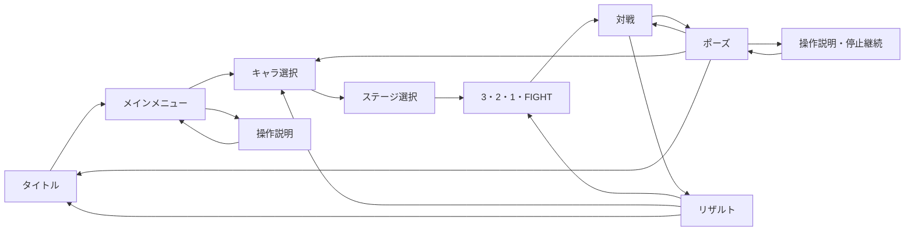

# フェーズ5 ゲーム設計

原本 [docs/SPEC_ORIGINAL.md](docs/SPEC_ORIGINAL.md) が優先です。対象指示書は [PHASE5.md](docs/codex_tasks/PHASE5.md)。技性能・背景・音・演出は本作独自のクロスオーバー表現です。資料で確認した設定は [CHARACTER_REFERENCE.md](docs/CHARACTER_REFERENCE.md) に分離します。

## 確定ルール

- 正式名は「あにあにバトル！！」、略称「あにバト！！」。オリジナル2D対戦アクション。
- 1対1、70秒、開始ハート3個。ハート0で敗北。両者同時KOは引き分け。
- 通常攻撃は被弾カウント+1。累計3回でハート1個を失い、カウントは0へ戻る。
- 蓄積はコンボが切れても保持し、時間・移動・ジャンプ・ガードでは回復しない。
- 地上・空中通常、左右移動、地上ダッシュ、ジャンプ、2段ジャンプ、空中ダッシュ、急降下。
- 同一攻撃インスタンスは同じ対象へ1回だけ命中。攻撃が新しい段へ進むと別IDになる。
- 共通地形は主足場1つ、小足場2つ。小足場は下から通過でき、下入力で降りられる。
- 左右・下の場外ラインを越えたら即敗北。フェーズ1ではこの基礎判定も実装。
- 同tickの終了優先順位は **場外 → ハート0 → 時間切れ**。両者が同じ最優先条件で敗北した場合は引き分け。
- 頭上カウンターはキャラへ追従し、HUDにも蓄積・ハート・残り時間を表示。終了後はリザルトで再戦。

## 原本で暫定、または本フェーズの暫定判断

- 時間切れはハートが多い側、同数なら通常被弾蓄積が少ない側、それも同数なら引き分け。
- 移動速度・攻撃フレーム・判定サイズ・40Fのコンボウィンドウなどは [BALANCE_CONFIG.md](BALANCE_CONFIG.md) の暫定値。
- 同一コンボでのハート減少は最大1（超必殺のみ例外）。特殊も同じハート減少予算を共有する。特殊を挟むと連続通常ヒット数は途切れるが、予算は最後の命中から40F経過するまで保持する。
- **暫定安全策：上限によりBREAKを止めた場合、被弾蓄積を2/3（閾値-1）で保持する。** 次の独立した機会の通常命中でBREAKする。蓄積を0へ消さない。
- 通常3連続命中で大吹っ飛び、COMBO FINISH、同じ攻撃者から48F追撃不可。別機会の累計3ヒットによるBREAKにはフィニッシュ演出を出さない。同tickに収集済みの追加接触にも追撃禁止を適用する。
- 通常攻撃は押下を連打して最大3段まで予約。押しっぱなしで自動連打しない。
- 場外判定の基準はキャラ中心、境界線上は場内。吹っ飛び中も判定する。2段ジャンプ・空中ダッシュ・上特殊で復帰でき、上特殊は着地まで再使用不可。
- 仮キャラA（青・四角）とB（桃・丸）は本作専用の試作表現。原作キャラや正史設定に対応させない。
- ポーズ画面はEsc/Startで開き、戦闘tickを停止。操作説明中も停止する。F11は全画面切替。

## 攻防の相性

| 攻撃 | 通常ガード | ジャストガード | 通常回避 | ジャスト回避 | 共通カウンター |
| --- | --- | --- | --- | --- | --- |
| 近距離通常 | 貫通 | 貫通 | 回避可 | 回避可 | 成功 |
| 遠距離通常・通常飛び道具 | 貫通 | 貫通 | 回避可 | 回避可 | 失敗 |
| 特殊 | 防御可 | 防御可 | 回避可 | 回避可 | 命中 |
| 超必殺 | 貫通 | 防御可 | 貫通 | 回避可 | 命中 |

通常は蓄積+1、特殊はハート-1、超必殺はハート-2。特殊・超必殺は通常蓄積を保持する。判定に触れなければダメージは発生しない。回避貫通フラグのある技は通常回避を貫通する。

ガードは押し続けて維持し、自発的な移動不可。特殊を受けるとガード硬直と押し返しが発生し、解除にも硬直がある。回避は地上・空中に対応し、短時間無敵の後に硬直。カウンターは8F受付、空振り24F硬直、成功後の再受付制限と攻撃者側の短い追撃無敵を持つ。近距離通常に対して同tickの受付開始でも優先される。成功で攻撃者の蓄積+1、3到達時はBREAKする。

## ジャスト判定（暫定）

防御開始フレームを0とし、接触時の防御年齢が0〜4の5F以内なら候補。開始前のtick状態で、既に有効な判定が自分のHurtboxと重なっていた攻撃IDは除外する。近接・飛び道具とも同じ基準で、未発生の攻撃やそのtickに新しく発生した攻撃は除外しない。将来の軌道を予測する判定ではない。

ジャストガードは自分のガード硬直2F、近接攻撃者へ12F硬直。ジャスト回避は成功時点から短い回復硬直3Fへ移り、近接攻撃者へ12F硬直。飛び道具に成功した場合は離れた発射者を止めず、自分の硬直短縮が反撃機会になる。いずれも専用イベントとゲージ増加を出す。防御開始前から重なっていた超必殺はジャスト不可で、通常ガード・通常回避を貫通する。

## 同時押しの優先順位

| 順位 | 行動 | 理由 |
| --- | --- | --- |
| 1 | 超必殺 | ゲージを消費する明確な意思を優先 |
| 2 | カウンター | 読み合いの受付を接触前に確定 |
| 3 | 回避 | 緊急防御を攻撃より優先 |
| 4 | 特殊 | 方向指定を通常より優先 |
| 5 | 通常 | ガードを崩す攻撃意思を優先 |
| 6 | ガード | 保持による防御 |
| 7 | ジャンプ | ダッシュと競合した際の復帰意思 |
| 8 | ダッシュ | 移動の強化 |
| 9 | 移動 | 方向のみの操作 |

行動可能時に実行可能な最上位を1つ選び、同時に入った低優先の押下は消費する。ガード保持中・攻撃中・回復硬直中などは現在の行動を継続し、キャンセルはしない。ガードを解除してから別行動へ移る。通常の次段予約は別に最大3段。方向＋特殊は上下を横より優先し、ボタン押下時の方向をラッチ／バッファに保存する。通常＋ジャンプ同時押しでは通常を選ぶ。

## 仮技・ゲージ

特殊4枠はニュートラル＝飛び道具、横＝突進、上＝復帰上昇、下＝その場の範囲攻撃。ゲージ不要。仮キャラA/Bは同じ暫定性能だが、独立アセットで調整可能。

作品リンクゲージは0〜100。命中12、被弾8、カウンター成功20、ジャストガード／回避18で増加。通常ガード・通常回避には増加なし。上限でクランプし、仮超必殺は100消費、1試合1回。空振り硬直60F。再戦でゲージ・使用回数をリセットする。数値は [BALANCE_CONFIG.md](BALANCE_CONFIG.md) にまとめる。

## 後続フェーズに残す原本ルール

サポート、パッド再割り当て専用UI、オンライン、正式な音源。ART2とフェーズ4のBuildAll／WindowsビルドはClaudeが確認済み（フェーズ4 EditMode204/204・PlayMode16/17）。CPU・手続き生成の音・演出はソース実装済みで、フェーズ5のUnity検証が必要です。

## 3キャラの方向性と暫定判断

- 透真：短い飛び道具と防御フィールド、速い通常、機動カウンターバフで間合いを調整するテクニカル型。解析は表示マークだけ。遮断ステップは短距離移動の終盤だけ打撃。無敵やアーマーは付けません。SF装備は本作専用で、原作の超能力ではありません。
- 蓮：最高のダッシュ速度、長い直線判定、縦横の突進。構えは受付中に新たな通常/特殊入力を待ち、カウンターとは別行動。直線番長が通常ガードされた時は42Fの隙が生じます。超必殺の十字は横長/縦長判定の和集合で四隅には当たりません。
- 千鶴：長めの通常射程、放物線投擲、30F麻痺、蓄積だけの自己回復。麻痺は最大45F、被弾硬直と並行し、アーマー・無敵はありません。食事は相手に当てる技ではなく補助技です。開始24F後に蓄積を1減らし、ハートは回復せず、4秒の再使用制限を消費。回復前に被弾すれば中断します。

全員、地上/空中3段・特殊4枠・超必殺1個を独立AttackDataで持ちます。数値は [BALANCE_CONFIG.md](BALANCE_CONFIG.md)。攻撃・カウンター効果は名前で分岐せず、データの効果欄を使用します。今後はBattleSetupのキャラ一覧へCharacterDataを加えることで追加できます。

超必殺開始イベントで30Fのカットイン。開始tickは通常の時間を消費し、その後の30tick呼び出しでは戦闘時計・物理・状態時間を止めます。両者同時開始は30Fを共有。停止中の押下を破棄し、再開時の保持入力だけを受け付けます。最終tickで開始しても時間切れを延期しません。これらは本フェーズの暫定演出ルールです。

BattleSetupは初期選択P1=透真/P2=蓮。タイトルからキャラ・ステージを選び、正式リザルトから再戦する。直接起動Battleのみ旧F1〜F4/Rを回帰確認用に保持。3キャラはART2の実スプライトを使用し、画像加工・技性能の変更はしない。

## ART1の表示

千鶴の通常姿はユーザーの私服設定画に従うドット絵。23アニメと小物3種を戦闘状態/攻撃経過へ同期し、シェフ服は将来用へ保管。AnimationSetがない透真/蓮は従来の仮図形。F9で判定枠を切り替えられます。戦闘の数値・ルールはフェーズ3を維持し、絵でダメージ範囲を変更しません。

## フェーズ4：共通縮小の暫定仕様

地形は全ステージが同じ `StageGeometryData`（CommonGeometry.asset）を参照する。各試合はその純C#スナップショットを持ち、元アセットや別試合の地形を変更しない。足場0を主足場、1・2を上部足場とする。StageDataは作品名・テーマ・時間帯キー・色・サムネ・視差・警告文・BGMキーを持ち、将来の時間帯差分もテーマアセットを差し替えられる。

- 55秒経過（残り15秒）：StageShrinkWarningで全体警告。
- 60秒経過（残り10秒）：StageShrinkStarted。まだ床は消えない。
- 61.8 / 63.6 / 65.4 / 67.2 / 69秒：5段階で左右端を同量ずつ消す。
- 各段の1秒前にStageSegmentWarning。消える左右区画が6tickごとに点滅し、StageShrunkで消滅する。
- 上部足場2つは2段目（63.6秒）で両方消す。62.6秒から両方に予告を出す。
- 最後は中央30%（標準幅36 → 10.8）。最終消滅を69秒に終え、残り1秒を確保する。
- 消滅は即死処理を行わず、支持を失ったキャラを非接地にして重力で落下させる。消滅tickでは古い接地状態による地上ジャンプを認めない。空中復帰は既存ルールを使う。
- 場外 → ハート0 → 時間切れの優先順位を維持。最後のtickで場外と時間切れが重なっても場外を優先する。
- カウントダウン、ポーズ、ポーズから開いた操作説明では戦闘tickを進めない。超必殺のカットイン中も縮小は試合時計と一緒に止まる。ヒットストップ中は従来どおり時計が進む。

背景は遠景・中景・床の自作シェイプ。星の終わりは建造物・塔・電子光と青い区画点滅、推し駒Battleは6×6盤面・巨大な駒・階層塔と床マス消失、Battle à la carteは屋台・鍋・皿・装飾と段階的な減光。背景演出から当たり判定を操作しない。これらは原作の正史を追加するものではなく、本作独自の仮背景。フェーズ5で各テーマに自作BGMループを接続した。

## フェーズ4：画面遷移

Titleシーン内でUIを切り替え、選択値はセッション内だけ保持する。2人対戦は各プレイヤーがキャラを決定してから進む。CPU戦はP1が相手と難易度も選び、P2へ純C# CPUのFrameInputを渡す。ランダムは試合開始時に1テーマへ解決し、再戦は同じテーマ。リザルトでは場外で画面外に落ちたキャラも含め、UIのwin/loseスプライトで両者を表示する。引き分けは両者loseを暫定採用し、引き分けと決着理由を別表示する。

3・2・1を各1秒、FIGHTを0.5秒表示し、この3.5秒は70秒に含めない。ポーズ再開時は時計・入力ラッチをリセットし、同フレームのメニュー決定を戦闘へ渡さない。フォーカス喪失時にもポーズする。UIは1920×1080基準のCanvasScalerと全体縮尺補正で収める。キーボード/個別割当パッドで操作可能。Scene・サムネPNG・新規アセットはBuildAllが生成するため、現在のソース更新だけでは生成済みシーンは置き換わらない。

## フェーズ5：CPU・入力・音・演出（当時の記録）

CPUはやさしい／ふつう／むずかしいの反応遅延・判断間隔・行動確率をScriptableObjectで調整。相手の状態を遅延付きで読む。場端・縮小の予告では中央へ移動し、落下中は残ったジャンプ・上特殊・空中ダッシュで復帰する。突進・回避・ダッシュは床内で終わることを確認して開始。通常3段・特殊4方向・防御・超必殺を、共通のFrameInput境界だけで操作する。ゲージはCPU810試合集計を受けて命中14／被弾10へ変更。原本の上限100・超必殺1回・ハート2は維持する。

全画面遷移で全員の決定／キャンセル／Startの解放を待ち、同じ押下の再使用を防ぐ。CPU戦のP2人間入力はシミュレーションへ渡さない。パッドは接続順にP1/P2へ割当、切断した機器は元の枠を予約する。Xbox/PSの操作と機器名を表示。別機器への交換用の専用UIは将来課題。

手続き生成のSEとメニュー／3ステージBGMを再生。音量と画面揺れはポーズから調整し端末保存。音と演出はBattleEventを読み、戦闘状態を変更しない。軽い揺れ、火花、ジャストフラッシュ／Spriteだけの短いスロー、カウンター／BREAK／COMBO FINISH、カットイン登場、決着バナーとwin/loseを表示する。ジャストのスロー中も位置・時計・判定は通常どおり。

ソース・.NET212件の検証まで完了。Unityで遊べることと実音は未確認。CPU同士は平均4〜7秒と短く、難易度とキャラ間バランス、縮小まで続く人間相手の試合は実機判断が必要。[phase5_final.md](docs/codex_logs/phase5_final.md)に確認手順を記載。

## フェーズ5B：滑らかさと試合テンポ（現行）

描画はBattleRunnerが保持する前／現tick位置を補間し、60Hzの決定的な戦闘から独立する。キャラ・弾・頭上UI・追従火花・カメラが同じ描画位置を使う。停止・大きな位置変更・向き反転は補間せず、アニメのコマ選択は現tick基準。モニター同期を既定とし、60/120/144/無制限をメニューとポーズから選んで端末保存する。追いつきは1描画フレーム最大5tick、超過時間は次フレームへ保持。

画面遷移では、その遷移を起こしたボタン／デバイスだけを離すまで無効にする。別キーや他パッドの決定、Esc／Startは直ちに使える。押下は物理エッジと入力更新番号で消費し、Input Systemの押下フラグが残っても別フレームで画面を飛ばさない。切断パッドの元の枠を予約し、他パッドを移動させない。

ハート減少後は75Fの立て直し無敵と点滅・間合いを離すノックバック。新たな接触で無敵を延長しない。通常3ヒット＝ハート1、特殊＝1、超必殺＝2、ハート3、同一コンボ最大1、70秒は保持する。攻撃系特殊は発生+12F・硬直+18F・ガード後最低48F、再使用120F（上特殊90F、食事240Fを維持）。画面内の弾は1人1発。CPUは特殊の予備動作への防御と攻撃後の間合い調整を増やし、ゲージは命中12／被弾8／カウンター16／ジャスト14。すべて定義／生成SOで調整可能。

主要14クリップ×3キャラを6〜8F・12〜15fpsに増量し、idleは1枚から胴・足固定の呼吸を生成する。既存キーポーズからの局所中割りで、原画の大きな細部差は残る。42GIFは`docs/art_wip/*_preview.gif`。

純C#230件とCPU810試合で検証。ふつうの平均45.51秒・縮小到達21.9%・超必殺あり56.7%、全難易度の自滅近似0。純C#既定値での集計で、実SO／Unity PlayMode／Windows／DualSense／144Hz実画面は未検証。対人難易度・相性・超必殺命中率は実機調整が必要。[phase5b_final.md](docs/codex_logs/phase5b_final.md)へ引き継ぐ。
