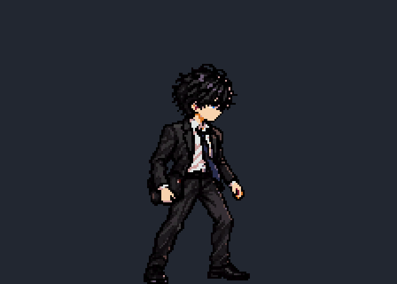
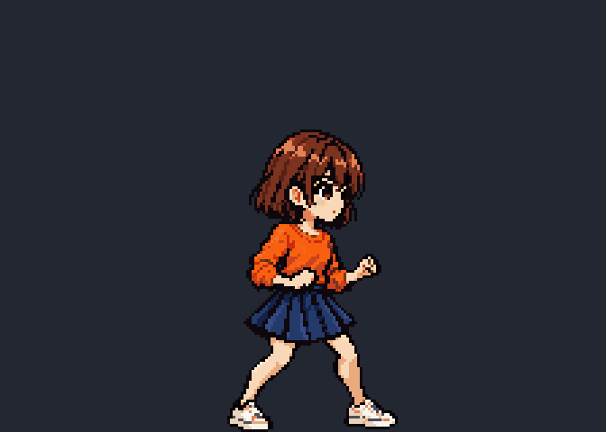

# ART3B待機プレビュー

全員224×160px/コマ、8F/6fps。以下は画素を変えない3倍表示（672×480px）。足は固定し、頭と体が上下±2px動きます。

| 透真 | 蓮 | 千鶴 |
|---|---|---|
|  |  |  |

[同倍率の静止一覧](art3b_idle_lineup.png)、[等倍シート・8枚・JSON](../../art_source/art3_idle/breathing/README.md)、[固定制作規格](../SPRITE_SPEC.md)。
