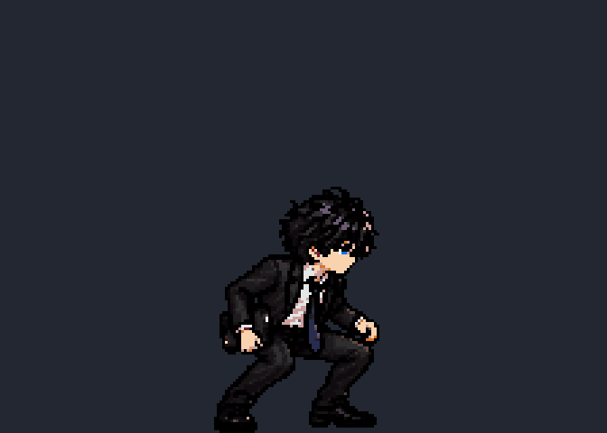
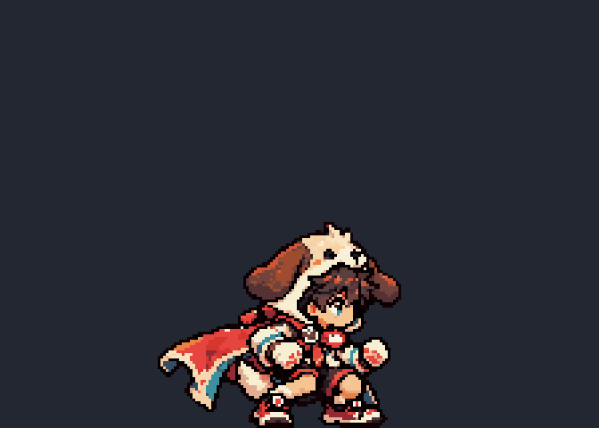
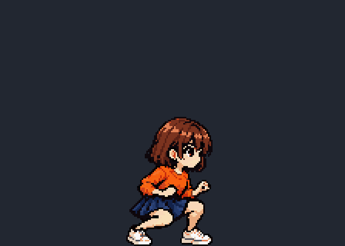
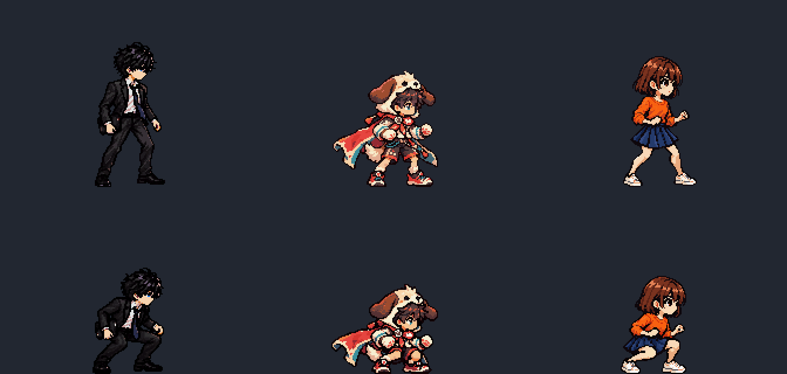

# ART3Cしゃがみプレビュー

全員224×160px/コマ、8F/6fps。以下は画素を変えない整数3倍表示（672×480px）。体と頭が上下±2px、靴の下12行は固定です。

| 透真 | 蓮 | 千鶴 |
|---|---|---|
|  |  |  |

上段は採用済み待機、下段は今回のしゃがみ。同じセル/倍率/接地位置で頭・靴・衣装・膝を比較できます。この一覧はPNGから作った素材比較で、Unity実画面ではありません。

[実装用8枚・シート・JSON・等倍GIF](../../art_source/art3_crouch/README.md)、[詳細な再制作指示書](../SPRITE_GENERATION_GUIDE.md)、[参照を含む持ち出しZIP](../../art_source/sprite_generation_kit.zip)。
