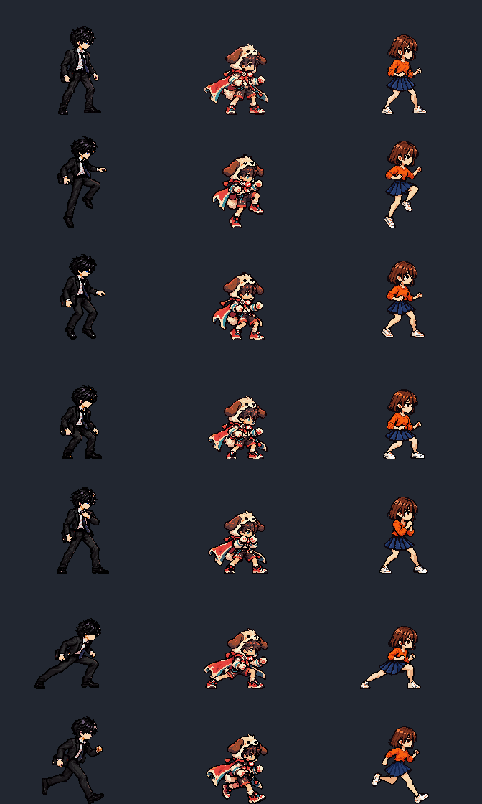

# ART3D素材プレビュー

これは素材のプレビューで、Windows実機スクリーンショットではない。列は透真/蓮/千鶴、比較画像の行は待機/上昇/下降/浅い着地/ガード/低い回避/ダッシュ。全コマ224×160、整数3倍。原画の立ち姿を物差しにして全キーを同倍率に正規化、頭部帯幅は採用待機±2px以内。

| 動作 | 透真 | 蓮 | 千鶴 |
|---|---|---|---|
| ジャンプ | [GIF](art3d_toma_jump_preview.gif) | [GIF](art3d_ren_jump_preview.gif) | [GIF](art3d_chizuru_jump_preview.gif) |
| 下降 | [GIF](art3d_toma_fall_preview.gif) | [GIF](art3d_ren_fall_preview.gif) | [GIF](art3d_chizuru_fall_preview.gif) |
| 浅い予備/着地→待機 | [GIF](art3d_toma_land_preview.gif) | [GIF](art3d_ren_land_preview.gif) | [GIF](art3d_chizuru_land_preview.gif) |
| ガード | [GIF](art3d_toma_guard_preview.gif) | [GIF](art3d_ren_guard_preview.gif) | [GIF](art3d_chizuru_guard_preview.gif) |
| 回避 | [GIF](art3d_toma_dodge_preview.gif) | [GIF](art3d_ren_dodge_preview.gif) | [GIF](art3d_chizuru_dodge_preview.gif) |
| ダッシュ | [GIF](art3d_toma_dash_preview.gif) | [GIF](art3d_ren_dash_preview.gif) | [GIF](art3d_chizuru_dash_preview.gif) |

ガードは1つの構え、下降は1つの下降姿勢を保持するクリップ。実ゲームでは地上予備は2tickだけ浅いかがみ、着地は8tickのかがみ→待機。確認GIFはlandクリップを15fpsで再生するので地上予備の実時間ではない。身体の上昇/下降の軌跡は戦闘シミュレーションで付ける。
