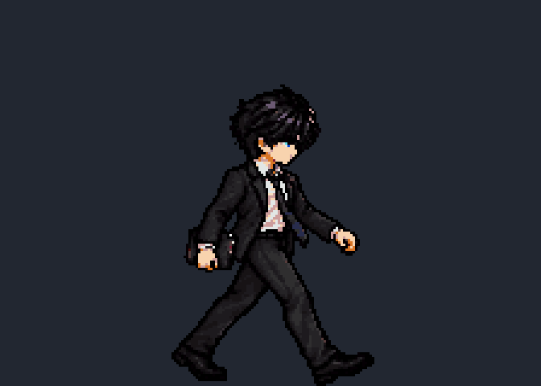
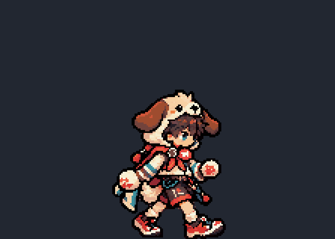
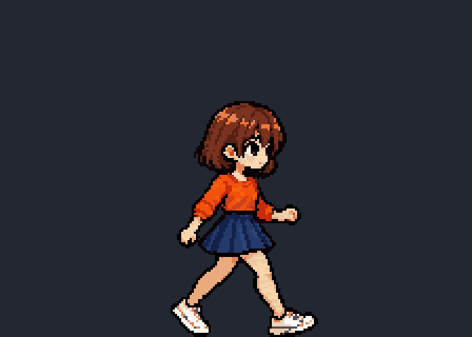

# ART3E：歩き8枚・左右交互・通常3段

素材プレビュー。全員224×160/コマ、PPU50、立ち倍率/共通32色。実機スクショではない。3人の歩きの両腕と透真の端末の持ち手を修正して接続/画素検査済み。PC終了のため走りの途中で停止、地上3段は未着手。今回Unity未実行。[再開/交代記録](../codex_logs/art3e_checkpoint.md)。

| キャラ | 8枚の別姿勢・15fps loop | 全8コマ/肩から手首/足の比較 |
|---|---|---|
| 透真 |  | [全コマ](art3e_toma_walk_frames.png) |
| 蓮 |  | [全コマ](art3e_ren_walk_frames.png) |
| 千鶴 |  | [全コマ](art3e_chizuru_walk_frames.png) |

[原画/実装PNG/再現](../../art_source/art3_walk_attacks/README.md)、[詳細生成条件](../SPRITE_GENERATION_GUIDE.md)§11、[左右の目視記録](../../art_source/art3_walk_attacks/gait-review.md)。
