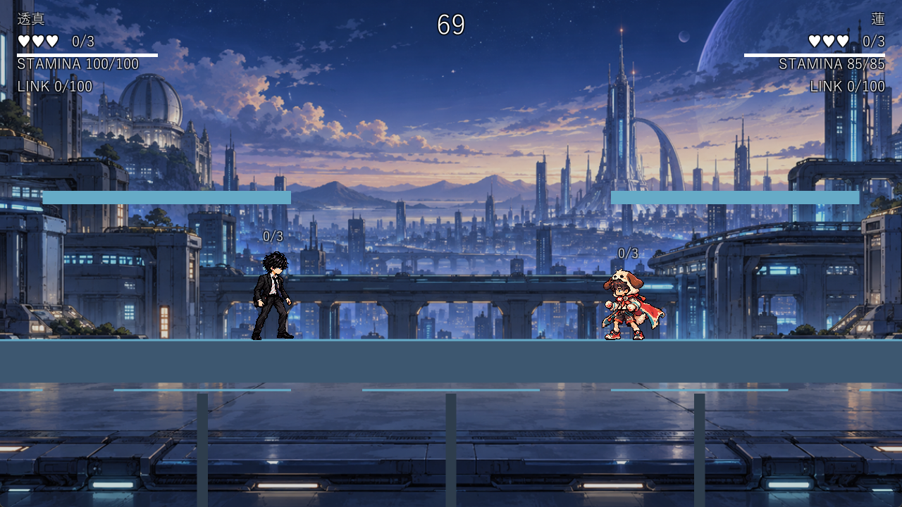
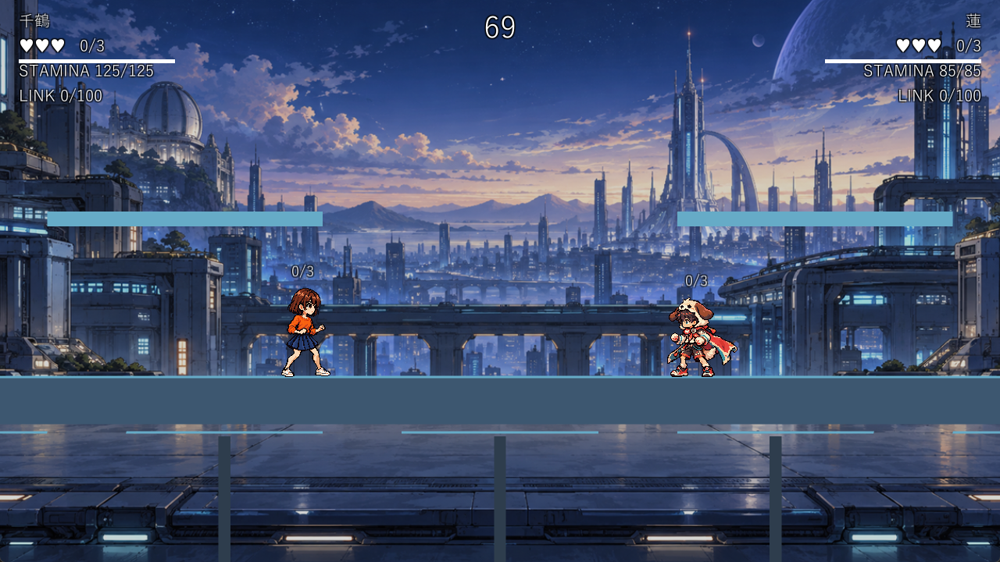

# ART3B：Windows版の実画面（2026-10-12）

Build/art3b/AniBato.exe、1280×720のゲーム表示領域をtools/verify/play_and_capture.ps1で撮影。事前に「PCに触らないで」と案内し、最前面のゲームだけに実キー入力を送った。各組のa/bは約340ms間隔で、足元が同じまま体・頭が少し上下する。透真/蓮と千鶴/蓮の2人対戦で全3人の新待機・接地・頭上カウンターを目視確認した。

| 画面 | ファイル |
|---|---|
| 透真/蓮、ステージ選択 | [stage_toma_ren](art3b_stage_toma_ren.png) |
| 透真/蓮の待機a | [toma_ren_idle_a](art3b_toma_ren_idle_a.png) |
| 透真/蓮の待機b | [toma_ren_idle_b](art3b_toma_ren_idle_b.png) |
| 千鶴/蓮の待機a | [chizuru_ren_idle_a](art3b_chizuru_ren_idle_a.png) |
| 千鶴/蓮の待機b | [chizuru_ren_idle_b](art3b_chizuru_ren_idle_b.png) |

全コマの呼吸は[GIF一覧](../art_wip/art3b_previews.md)。今回は待機の接続確認で、物理パッド・144Hz・全モーションの新絵柄化の完了記録ではない。
